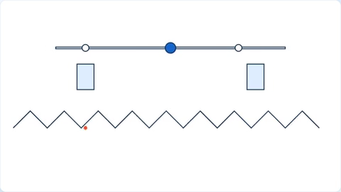

# AI 制作 MG 素材真实评测

2026-11-20，使用工作台钥匙串配置调用 `deepseek-v4-pro`。只使用方案中的 5 个描述和医疗蓝主题。每条草稿均通过受限 SVG、主题色、关键帧及事件校验，并从离线舞台生成 MP4 预览。

5/5 通过机器校验。本次共 5 次模型请求，自动修正 0 次。实际返回用量为输入 3,127 Token、输出 7,064 Token，按工作台公开费率估算 ¥0.21218940。方舟图片、方舟视频、数字人及云配音调用均为 0 次。

5 份真实草稿均留在待确认区。下面的评价来自实际预览截图，需要药师和设计人员复核，尤其要评估机理、动作位置、观察角度和信息是否足以被正确理解。

| 序号 | 描述 | 轨道数 | 音效事件数 | ffprobe 预览时长 | 等待 | 相邻抽帧最大 RGB 平均差 | 估算费用 |
| --- | --- | ---: | ---: | ---: | ---: | ---: | ---: |
| 1 | 药片经食道进入胃部并溶解 | 10 | 2 | 4.000 s | 11.794 s | 3.427 | ¥0.03727800 |
| 2 | 降压药让血管扩张 | 5 | 1 | 3.000 s | 9.076 s | 5.023 | ¥0.02376000 |
| 3 | 滴眼液滴入下眼睑 | 8 | 3 | 4.000 s | 19.954 s | 8.451 | ¥0.03334500 |
| 4 | 漏服药物的时间线判断 | 13 | 1 | 3.000 s | 14.501 s | 4.983 | ¥0.04208220 |
| 5 | 抗生素作用于细菌 | 30 | 5 | 3.000 s | 29.016 s | 2.699 | ¥0.07572420 |

## 逐条评测

### 1. 药片经食道进入胃部并溶解

食道到胃的路径可辨，药片缩小并散开。器官造型过于简略，药片消失的位置不够清楚。

设计可沿用路径分段，补画胃部轮廓并明确溶解发生的位置。药师核对它对应的剂型。

[开场](验收截图/G/G3-评测1-开场.png) · [动作](验收截图/G/G3-评测1-动作.png) · [收尾](验收截图/G/G3-评测1-收尾.png)

### 2. 降压药让血管扩张

轮廓随时间展开。中间帧看起来更像弯曲轨道，管腔扩大与血流的关系不够直接。

改用较明确的血管纵剖或横剖比较。药师明确适用药物，避免把机理泛化到所有降压药。

[开场](验收截图/G/G3-评测2-开场.png) · [动作](验收截图/G/G3-评测2-动作.png) · [收尾](验收截图/G/G3-评测2-收尾.png)

### 3. 滴眼液滴入下眼睑

液滴和眼部有前后动作。中间帧的落点靠近眼睛中心，瓶口、下眼睑和结膜囊区分不足。

需要调整视角和落点，药师确认后再作为操作演示。

[开场](验收截图/G/G3-评测3-开场.png) · [动作](验收截图/G/G3-评测3-动作.png) · [收尾](验收截图/G/G3-评测3-收尾.png)

### 4. 漏服药物的时间线判断

节点、当前时点和进度顺序可辨。下方折线没有明确定义，图形本身无法表达不同药品的判断条件。

可保留时间线。加入由药师确认的节点文字并删去含义不明的折线。

[开场](验收截图/G/G3-评测4-开场.png) · [动作](验收截图/G/G3-评测4-动作.png) · [收尾](验收截图/G/G3-评测4-收尾.png)

### 5. 抗生素作用于细菌

药物图形与圆形细菌区域分开，存在靠近和改变状态的动作。没有充分表现药物作用到细菌的具体环节。

需要明确作用对象和视觉机制。由药师先选一种机制，再由设计重画，避免把示意当成所有抗生素的通用过程。

[开场](验收截图/G/G3-评测5-开场.png) · [动作](验收截图/G/G3-评测5-动作.png) · [收尾](验收截图/G/G3-评测5-收尾.png)
