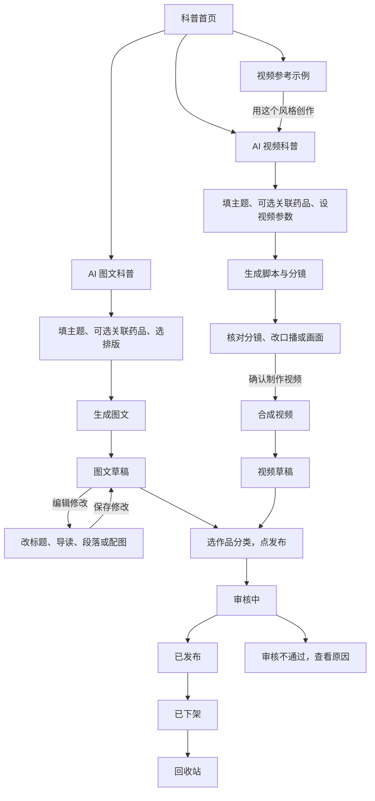

# 希息药事 · 科普制作流程

药师从「科普」进入制作。**图文先生成整篇草稿，再改正文和配图；视频先生成可编辑的脚本与分镜，确认后才合成成片。** 两条路径在成品草稿处汇合，接下来选作品分类、提交审核，再从「我的科普作品」管理发布结果。数字人形象和配音音色是视频可用的素材，可以提前准备。

依据为 2026-11-18 查看时的 [Figma「v1.8-健康科普」页面][source]。已盘点该页 50 个页面、弹窗及局部设计稿，核对关键界面截图。该页未读到原型连线、流程起点或页面评论，所以下图的箭头是依据控件、文案及前后画面还原的操作顺序。文内的费用、时长、数量均按画面示例解释。

## 1. 从哪里开始

底部导航为「任务 / 科普 / 我的」。同页有五张名为「科普」的首页稿。后续演示可先用带「视频参考示例 / 我的作品」切换的首页串联入口，因为这版同时覆盖直接创作、按示例创作和回看作品。另有「AI 演播室定制」布局，以及突出视频制作的布局；页面未指定定稿。[首页][home] · [另一种首页布局][home2]

| 用户想做什么 | 从首页怎么走 |
| --- | --- |
| 从零创作 | 点「AI 图文科普」或「AI 视频科普」，进入对应制作表单。 |
| 照某种风格做视频 | 「视频参考示例」展示六种风格的封面、示例标题与「用这个风格创作」。可据此还原为打开视频表单并预选对应风格，是否同时带入示例主题待确认。[示例卡片][examples] |
| 用自己的形象或声音 | 首页的「数字人形象」「音频音色」分别进入管理，视频表单也有「管理」入口。 |
| 接着处理已有作品 | 「我的作品」区有作品卡及「待发布草稿」卡。「作品列表」进入完整列表；草稿卡直达草稿箱。 |

## 2. 两种制作都用到的输入

**主题。** 图文填写「科普主题或需求提示词」，视频填写「短视频脚本主题或核心疑问」，均显示 `0/300`。示例提示用户描述受众和要解释的问题，视频还可描述开场、口播和结尾。空主题的提交反馈没有单独画面。[图文输入][text-input] · [视频输入][video-input]

**关联药品是选填项。** 初始画面两种方式都未选。选择「宽泛用药科普」后，该选项直接打勾；选择「匹配具体药品」后，通过「搜索并选择药品」打开选择器，搜索、单选一项并点「确定」。回到表单后显示药名标签，点标签上的 × 可移除。可见搜索框提示「搜索药品名称」，按厂家或规格搜索的能力未核实。药品关联发生在生成前，作品分类发生在发布前，两者应分别保存。[选择方式][drug-mode] · [药品选择器][drug-picker] · [选中回显][drug-selected]

## 3. 图文制作

| 步骤 | 药师操作与界面结果 |
| --- | --- |
| 1. 设置内容 | 输入主题，按需关联药品。排版三选一：「通俗图解版」讲求易懂、配图丰富，截图中已选；「临床深度版」侧重药理机制与指南依据；「避坑问答版」以问答解释常见错误。底部显示本次 20 医豆、可用 1350 医豆，点「开始 AI 制作」。[制作表单][text-input] |
| 2. 等待图文 | 进度页依次展示检索指南与病种资料、润色语言与提炼要点、生成两张插图与排版。文案说明完成后自动保存到「我的作品」并展示成品；结合草稿详情和草稿箱，完成时应展示「草稿中」。这些是界面表达的处理阶段。[生成中][text-loading] |
| 3. 审读草稿 | 从上到下可见草稿状态、时间与消耗、标题、作品分类、药师核心导读、穿插配图的正文、学术参考文献与 AI 辅助生成说明。底部有「编辑修改」「发布」。内容满意时，可直接选分类并提交。[草稿详情][text-draft] |
| 4. 编辑并保存 | 可修改标题、导读和分段正文。示例有三段正文、两张配图；导读、正文块和配图旁有删除图标，也可「添加一段新正文」「添加图片」。参考文献区域在编辑页可见，其可编辑性未标明。底部「保存修改」对应回看成品；另有整篇「重新生成」，费用及覆盖范围未说明。[图文编辑][text-edit] |
| 5. 只换一张配图 | 在目标图片上点「重新生成图片（5医豆）」，弹窗内修改该段的图像提示词，再取消或确认。演示时，取消应保留原图；确认仅更新这张图并保留其他段落。[配图重生成][text-image] |

## 4. 视频制作

**第一步，配置要生成的视频。** 主题和关联药品与图文共用。视频表单另外包含以下设置。[视频制作表单][video-input]

| 设置 | 画面中的选项与初始示例 |
| --- | --- |
| 画幅 | 竖屏 9:16（已选）、横屏 16:9、「方屏 3:4」（原型用词）。 |
| 时长 | 滑杆两端标 30 秒、120 秒，截图当前值 90 秒。步长未标明。 |
| 数字人形象 | 标注「可选可不选」，示例中选中「官方默认」，也有「我的专属」和管理入口。 |
| 配音音色 | 可试听、选择或进入管理。预设示例为知性女声·晓雅（已选）、温柔女声·小暖、沉稳男声·子航、阳光男声·小柯。 |
| 视频风格 | 手绘动画风（已选）、清新写实风、科技数据风、气泡讲解风、玻璃拟态风、3D质感风，与首页六类参考示例对应。 |

**第二步，生成脚本与分镜。** 表单底部示例为本次 50 医豆、可用 1350 医豆。点「生成脚本与分镜」后，进度页展示构思开场和药理拆解、匹配口播语速和字幕分段、生成分镜图和画面指示。生成结果先进入脚本编辑。[脚本生成中][script-loading]

**第三步，逐镜核稿。** 编辑页展示视频主题标题、画幅、预计时长。示例的四幕依次为痛点开场（0–8 秒）、药理拆解（8–22 秒）、药师总结（22–36 秒）、安全提示与收尾（36–45 秒）。每幕都有时间段、画面和可修改的口播词；改某一幕的图片时，可调整该幕的视觉要求，再确认消耗 8 医豆重新生成。底部另有整套「重新生成」和「确认制作视频（50医豆）」。[分镜编辑][script-edit] · [单镜重生成][shot-image]

**第四步，合成并回看。** 确认制作后才进入合成进度页，依次展示音色与唇形匹配、分镜与动画融合、生成视频文件。页面提示完成后自动保存。成品草稿有播放器、AI 辅助生成标识、状态、时间、消耗、分类、画幅、总时长和可收起的逐幕口播。底部只展示「发布」；原型明确画出的口播修改入口在合成前。[视频合成中][render] · [视频草稿][video-draft]

## 5. 视频的可选支线：准备专属素材

### 数字人形象

1. **从管理页新增。** 「数字人形象管理」有官方默认形象，以及可查看、改名、删除的自定义形象，也展示「制作中」。点「新增数字人形象」进入克隆教程。[形象管理][avatar-list]
2. **准备素材。** 教程列出半身或全身远景、正对镜头、包含嘴巴闭合的画面，以及视频大于 15 秒、MP4、300M 以内。页面提供《形象克隆协议》勾选项、「在线录制」和「上传视频」。管理入口另写「上传照片」，两处口径待定。[形象克隆教程][avatar-guide]
3. **在线录制。** 初始摄像头未开启，按录制键征得同意后进入相机预览，再点开启录像。界面有提词器、翻转和计时（上限显示 02:00）。完成后可预览、重录，或点「开始制作数字人形象」。上传视频的文件选择及校验反馈未画出。[未开摄像头][cam-off] · [开启后][cam-on] · [录制完成][capture-done]
4. **训练、命名和复用。** 训练页预计 1–3 分钟，可以「返回（后台继续制作）」，文案说明完成后会加入形象列表。结果页可预览、改形象名称、设置自定义音色并「保存数字人形象及专属音色」。重新生成需重新录制或上传，会更新当前形象；删除有不可恢复的确认弹窗。[训练中][training] · [制作结果][avatar-done] · [删除确认][avatar-delete]

### 配音音色

「音频音色管理」支持试听，官方预设不可删除；自定义音色有改名、制作中和删除状态。点「新增配音音色」，根据示例朗读，界面建议在安静环境录制 5–10 秒。录音面板分为「等待开始录音」→「正在录音中」（计时至 00:10，可点「完成录音」）→「录制完成」。完成后可命名、试听原声、重新录制或「保存为我的专属音色」。删除自定义音色需确认，提示不可恢复。[音色管理][voice-list] · [录音前][voice-start] · [录音中][voice-record] · [录音后][voice-done] · [删除确认][voice-delete]

## 6. 作品分类、审核和去向

**分类在成品详情选择。** 图文和视频草稿均带星号标记「作品分类」。选择器支持多选十个常用分类：慢病管理、心脑血管、内分泌代谢、急诊安全、消化系统、家庭常备、五官呼吸、风湿免疫、营养保健、神经睡眠。也可输入最多 8 字的自定义标签，点「保存标签」。底部「确定」显示已选数量；确定后在详情回显，可点标签删除或「重新选择」。有已选 0 个和 2 个两种弹窗画面，空分类发布时的提示未画出。[分类选择器][categories] · [零选择状态][categories-empty] · [详情回显][tags]

| 作品状态 | 从哪里查看，可以做什么 |
| --- | --- |
| 草稿中 | 从生成完成页或待发布草稿卡进入。草稿箱列出类型、标题、原始提示词和时间，图文有「编辑修改」「发布」，视频有「发布」。卡片还有删除图标，删除后的去向未说明。[草稿箱][drafts] |
| 审核中 | 从「发布」推断进入审核。两种详情都显示状态、分类和作品内容，详情中未见编辑或再次发布按钮。草稿箱的审核中视频卡却仍画有「发布」，重复提交规则待定。[图文审核][text-review] · [视频审核][video-review] |
| 审核不通过 | 详情显示退回原因。图文保留「编辑修改」「发布」，可按意见改稿再提交。视频提示修改后重新制作，但该详情未画重做入口，不能据此确定从哪里返回脚本。[图文退回][text-reject] · [视频退回][video-reject] |
| 已发布 | 图文和视频详情均提供「下载」「下架」。已发布列表提示作品将在注册医院的「AI数智人药师」小程序展示，并有「去看看」入口。文件下载格式和小程序内页面未展示。[图文已发布][text-live] · [视频已发布][video-live] · [已发布列表][works] |
| 已下架 | 可在「我的科普作品 → 已下架」查看；卡片的删除图标打开「移入回收站？」。取消保留原作品，确认后移入回收站。原型未画重新上架入口。[已下架列表][offline] · [移入确认][move-bin] |
| 回收站 | 每条显示删除时间、剩余保留天数、原始提示词和已消耗医豆。90 天内可「恢复到我的作品」或「彻底删除」；到期自动清除。也可「清空回收站」，弹窗明确清空后无法恢复。恢复落在哪个列表未说明。[回收站][bin] · [清空确认][empty-bin] |

## 7. 后续 HTML demo 怎么核对

建议以移动端单栏展示，用同一条样例作品从输入走到成品。生成进度、审核结果和素材训练可以模拟；保留用户实际输入的主题、选择的风格、编辑过的内容及分类，演示者才能看出每步操作的后果。以下是复现流程的验收场景。

| 场景 | 连续操作 | 可观察的结果 |
| --- | --- | --- |
| 图文从零到送审 | 匹配一种药品 → 选排版 → 制作 → 改一段正文、重生成一张图 → 保存 → 选分类 → 发布 | 药名可移除；替换配图只影响目标段；回看能看到修改与标签；提交后显示审核中。 |
| 视频按风格创作 | 点某示例的「用这个风格创作」→ 选画幅、时长和音色 → 生成脚本 → 改一幕口播 → 合成 | 表单可看到对应风格；合成前可核对脚本；成片详情含相应画幅，并能展开、收起修改后的分镜词。 |
| 素材复用 | 从视频表单进入管理 → 分别体验形象制作、音色录制 → 保存并回到制作表单 | 可找到新素材并选用；建议保留进管理页前已填写的主题与参数。 |
| 审核分流 | 用预置结果分别展示图文退回、视频退回和审核通过 | 退回有具体原因；图文可编辑再送审；通过后出现下载、下架动作。 |
| 下架与恢复 | 已发布作品下架 → 删除时先取消，再确认 → 从回收站恢复 | 取消后作品仍在已下架列表；确认后出现在回收站；恢复后从回收站移出。 |

### 会改变演示行为的待确认项

| 问题 | 原型证据 | 首版演示建议 |
| --- | --- | --- |
| 视频到底扣几次医豆？ | 生成脚本前显示本次 50、余额 1350；分镜页余额 1300，又标「确认制作视频（50医豆）」；成品详情示例却是「消耗 20 医豆」。整篇、整套重新生成的费用也未说明。 | 可显示各动作的原型报价；累计扣费、余额不足和失败退费留待费用规则确认。 |
| 用户选的规格如何传到成片？ | 表单示例为 9:16、90 秒，分镜示例为 9:16、预计 45 秒，成片示例为 16:9、45 秒。 | 同一演示作品沿用所选画幅；分别展示配置时长与脚本预计时长，并使分镜时间段与实际演示片长一致。 |
| 哪些动作会被拦截或返回重做？ | 分类标必填，但缺少空分类提交反馈；审核中列表与详情按钮不同；视频退回原因要求重做但没有入口。 | 可先用「至少选一个分类」作演示校验；审核中详情只读。视频退回先展示原因，重做入口待定。 |
| 形象素材支持哪种上传？后台完成后还需手动保存吗？ | 管理卡写「上传照片」，教程写「上传视频」；训练页称自动入列表，结果页另有保存动作。 | 上传先按教程演示视频素材；保留后台制作及结果页命名保存两个状态。 |
| 回收站恢复后是否重新公开？ | 恢复按钮只承诺返回「我的作品」，没有写明上下架状态。 | 演示可暂回「已下架」，待产品确认；避免一次恢复操作让作品意外公开。 |

[source]: https://www.figma.com/design/EK5wzoaRdlu1XnH8g4TbFC/?node-id=3115-5695
[home]: https://www.figma.com/design/EK5wzoaRdlu1XnH8g4TbFC/?node-id=3210-5772
[home2]: https://www.figma.com/design/EK5wzoaRdlu1XnH8g4TbFC/?node-id=3184-5053
[examples]: https://www.figma.com/design/EK5wzoaRdlu1XnH8g4TbFC/?node-id=3248-14217
[text-input]: https://www.figma.com/design/EK5wzoaRdlu1XnH8g4TbFC/?node-id=3184-3181
[video-input]: https://www.figma.com/design/EK5wzoaRdlu1XnH8g4TbFC/?node-id=3184-3548
[drug-mode]: https://www.figma.com/design/EK5wzoaRdlu1XnH8g4TbFC/?node-id=3248-10418
[drug-picker]: https://www.figma.com/design/EK5wzoaRdlu1XnH8g4TbFC/?node-id=3248-10708
[drug-selected]: https://www.figma.com/design/EK5wzoaRdlu1XnH8g4TbFC/?node-id=3248-10105
[text-loading]: https://www.figma.com/design/EK5wzoaRdlu1XnH8g4TbFC/?node-id=3184-3273
[text-draft]: https://www.figma.com/design/EK5wzoaRdlu1XnH8g4TbFC/?node-id=3184-3327
[text-edit]: https://www.figma.com/design/EK5wzoaRdlu1XnH8g4TbFC/?node-id=3184-3397
[text-image]: https://www.figma.com/design/EK5wzoaRdlu1XnH8g4TbFC/?node-id=3184-3513
[script-loading]: https://www.figma.com/design/EK5wzoaRdlu1XnH8g4TbFC/?node-id=3184-3650
[script-edit]: https://www.figma.com/design/EK5wzoaRdlu1XnH8g4TbFC/?node-id=3184-3704
[shot-image]: https://www.figma.com/design/EK5wzoaRdlu1XnH8g4TbFC/?node-id=3184-3868
[render]: https://www.figma.com/design/EK5wzoaRdlu1XnH8g4TbFC/?node-id=3184-3903
[video-draft]: https://www.figma.com/design/EK5wzoaRdlu1XnH8g4TbFC/?node-id=3184-3958
[avatar-list]: https://www.figma.com/design/EK5wzoaRdlu1XnH8g4TbFC/?node-id=3190-600
[avatar-guide]: https://www.figma.com/design/EK5wzoaRdlu1XnH8g4TbFC/?node-id=3184-5568
[cam-off]: https://www.figma.com/design/EK5wzoaRdlu1XnH8g4TbFC/?node-id=3191-1662
[cam-on]: https://www.figma.com/design/EK5wzoaRdlu1XnH8g4TbFC/?node-id=3191-1809
[capture-done]: https://www.figma.com/design/EK5wzoaRdlu1XnH8g4TbFC/?node-id=3191-3178
[training]: https://www.figma.com/design/EK5wzoaRdlu1XnH8g4TbFC/?node-id=3191-3254
[avatar-done]: https://www.figma.com/design/EK5wzoaRdlu1XnH8g4TbFC/?node-id=3191-3324
[avatar-delete]: https://www.figma.com/design/EK5wzoaRdlu1XnH8g4TbFC/?node-id=3190-971
[voice-list]: https://www.figma.com/design/EK5wzoaRdlu1XnH8g4TbFC/?node-id=3190-456
[voice-start]: https://www.figma.com/design/EK5wzoaRdlu1XnH8g4TbFC/?node-id=3191-2833
[voice-record]: https://www.figma.com/design/EK5wzoaRdlu1XnH8g4TbFC/?node-id=3191-2645
[voice-done]: https://www.figma.com/design/EK5wzoaRdlu1XnH8g4TbFC/?node-id=3191-2208
[voice-delete]: https://www.figma.com/design/EK5wzoaRdlu1XnH8g4TbFC/?node-id=3190-986
[categories]: https://www.figma.com/design/EK5wzoaRdlu1XnH8g4TbFC/?node-id=3248-12567
[categories-empty]: https://www.figma.com/design/EK5wzoaRdlu1XnH8g4TbFC/?node-id=3248-12869
[tags]: https://www.figma.com/design/EK5wzoaRdlu1XnH8g4TbFC/?node-id=3248-13246
[drafts]: https://www.figma.com/design/EK5wzoaRdlu1XnH8g4TbFC/?node-id=3184-4218
[text-review]: https://www.figma.com/design/EK5wzoaRdlu1XnH8g4TbFC/?node-id=3206-4585
[video-review]: https://www.figma.com/design/EK5wzoaRdlu1XnH8g4TbFC/?node-id=3206-3885
[text-reject]: https://www.figma.com/design/EK5wzoaRdlu1XnH8g4TbFC/?node-id=3216-6192
[video-reject]: https://www.figma.com/design/EK5wzoaRdlu1XnH8g4TbFC/?node-id=3216-6111
[text-live]: https://www.figma.com/design/EK5wzoaRdlu1XnH8g4TbFC/?node-id=3207-4919
[video-live]: https://www.figma.com/design/EK5wzoaRdlu1XnH8g4TbFC/?node-id=3207-5021
[works]: https://www.figma.com/design/EK5wzoaRdlu1XnH8g4TbFC/?node-id=3184-4071
[offline]: https://www.figma.com/design/EK5wzoaRdlu1XnH8g4TbFC/?node-id=3185-5745
[move-bin]: https://www.figma.com/design/EK5wzoaRdlu1XnH8g4TbFC/?node-id=3190-145
[bin]: https://www.figma.com/design/EK5wzoaRdlu1XnH8g4TbFC/?node-id=3184-4320
[empty-bin]: https://www.figma.com/design/EK5wzoaRdlu1XnH8g4TbFC/?node-id=3190-146
